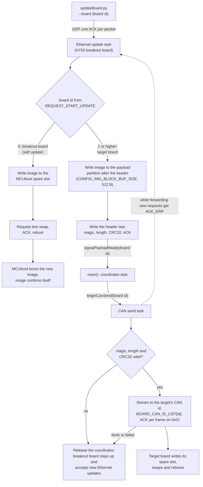

# sc2.5-canBreakoutUpdater

Zephyr firmware for the CAN breakout boards, with firmware
updates delivered over Ethernet and forwarded to other boards over CAN.

## What it does

The board runs an application on top of MCUboot with two image slots. A
background task brings up the Ethernet interface and listens on UDP for a new
firmware image. Every update starts by naming the board it is for:

- **The breakout board itself** — the task writes the image into the spare
  slot, asks MCUboot to boot it, and reboots; on the next boot the new image
  runs, confirms itself, and becomes permanent (a bad image is rolled back
  automatically by MCUboot).
- **A target board on the CAN bus** — the task writes the
  image into a separate payload partition instead, then hands it off. A CAN task
  checks the stored image and streams it to the target board, which writes it
  into its own spare slot and reboots the same way. The breakout board keeps
  running; once the forward ends it accepts new updates again.

The Ethernet and CAN update tasks never talk to each other directly; `main()`
runs a small coordinator that passes the payload and the target board from one
to the other. While a CAN forward is running, the board refuses new Ethernet
update requests.

The peripheral drivers (CAN, ADC, DAC, PID, INA281, thermistor), the update
tasks, and the coordinator come from the `embedded-pio` submodule, and the board
definitions from the `boards` submodule. The firmware targets the Nucleo H753ZI
BSP (`nu_h753zi_bsp`).

`updateBoard.py` is the host-side tool that pushes a signed image to the board
over that UDP protocol.

## How an update is handed off



## Boards

`updateBoard.py` takes the numeric board id. Use this table to look up the id
for the board you want to update:

| Board id (`--board`) | Board | CAN id | Delivered by |
|---|---|---|---|
| `0` | CAN breakout board (`CAN_BREAKOUT_BOARD`) | `0xFF` *(not used on CAN)* | Ethernet, straight into the breakout board's spare slot |
| `1` | PDC (`PDC`) | `0xAA` | Ethernet to the breakout board, then CAN to the target board |

The board ids are the `board_id_t` enum and the CAN ids are
`BOARD_CAN_ID_LIST` in `embedded-pio/coordinator/coordinator.h`; the list is
indexed by board id.

### Adding a target board

1. Add the board to `board_id_t` in `coordinator.h`.
2. Add its CAN id to `BOARD_CAN_ID_LIST` at the same index.
3. Add a row for it to the table above, so users can find its id.
4. In the target board's own firmware, start `canUpdateTask` with its board id
   through `p1`, e.g. `K_THREAD_DEFINE(..., canUpdateTask, (void *)PDC, ...)`
   The task listens on the CAN id looked up from that board id.

## Using `updateBoard.py`

Pushes an MCUboot-signed image to a running board over UDP, waiting for an
acknowledgement after every packet. `--board` takes the id of the board the
image is for (see [Boards](#boards)).

### Network setup

The board and host must be on the same subnet with these fixed addresses:

| | Address | Port |
|---|---|---|
| Board (MCU) | `192.168.1.1` | `12345` |
| Host (PC)   | `192.168.1.2` | `12345` |

The board only accepts packets **from** `192.168.1.2:12345`, so the host must
send from that exact address and port — pass `--bind 192.168.1.2` (the script
binds the same port it sends to). Give the host NIC the static IP
`192.168.1.2 / 255.255.255.0`. No gateway is needed.

### Assigning the host IP (Windows)

The script does **not** configure your network adapter — it only sends from an
address that must already exist on it. You have to assign `192.168.1.2` to the
Ethernet adapter yourself before running the script, or the `--bind` will fail
with an "address not available" error. Do this once per machine.

**Using Settings (Windows 11):**

1. Plug the board into the host's Ethernet port (directly, or through the same
   switch/USB-Ethernet adapter).
2. Open **Settings → Network & internet → Ethernet**.
3. Click the adapter the board is on, find **IP assignment**, and click **Edit**.
4. Choose **Manual**, turn **IPv4** on, and enter:
   - IP address: `192.168.1.2`
   - Subnet mask: `255.255.255.0`
   - Gateway / DNS: leave blank
5. Save.

**Or using PowerShell (run as Administrator):**

```powershell
# find the adapter name (e.g. "Ethernet", "Ethernet 2")
Get-NetAdapter

# assign the static IP (replace "Ethernet" with your adapter's name)
New-NetIPAddress -InterfaceAlias "Ethernet" -IPAddress 192.168.1.2 -PrefixLength 24
```

**Verify** the board is reachable before updating:

```powershell
ping 192.168.1.1
```

A reply means the link and addressing are correct and you can run the update. If
it times out, re-check the cable, the adapter you configured, and that the board
is powered and running. (A USB-Ethernet adapter must also have its driver
installed and not be set to a fixed speed/duplex that the board can't match.)

To undo the static IP later, set the adapter's IP assignment back to
**Automatic (DHCP)** in Settings, or run
`Remove-NetIPAddress -InterfaceAlias "Ethernet" -IPAddress 192.168.1.2`.

### Which file to send

Send the **signed** application image for the board being updated, not the raw
`.bin`. For the breakout board itself that is this repo's build output:

```
build/sc2.5-canBreakoutUpdater/zephyr/zephyr.signed.bin
```

(or the equivalent path under whatever `--build-dir` you built into). For a
target board, send that board's own firmware `zephyr.signed.bin`. The image path
is required — there is no default.

Only the `.bin` is supported for now. The script sends the file's bytes as-is,
so a `zephyr.signed.hex` (Intel HEX text, roughly 2.7 times larger) gets written
into the slot as text and MCUboot rejects it after the transfer.

A forwarded image has to fit in the payload partition: 384 KB minus the header,
which is `CONFIG_IMG_BLOCK_BUF_SIZE` (512 B), so at most 392,704 bytes.

### Command

Update the breakout board itself (board id `0`, the default):

```bash
py updateBoard.py build/sc2.5-canBreakoutUpdater/zephyr/zephyr.signed.bin --bind 192.168.1.2
```

Update a target board through the breakout board, passing its board id. For example:

```bash
py updateBoard.py path/to/target/zephyr.signed.bin --board 1 --bind 192.168.1.2
```

### Arguments

| Argument | Default | Meaning |
|---|---|---|
| `image` | *(required)* | Path to the signed image to send. |
| `--board` | `0` | Board id to update: `0` is the board on Ethernet, any other id is forwarded over CAN. Decimal or hex (`1`, `0x01`). See [Boards](#boards). |
| `--ip` | `192.168.1.1` | Board address. |
| `--port` | `12345` | Board UDP port (host binds the same port). |
| `--bind` | *(none)* | Host IP to send from; set to `192.168.1.2`. |
| `--pad` | `0xFF` | Fill byte for the final chunk's trailing bytes. |
| `--warmup` | `1.5` | Seconds to wait before the handshake, so the board has armed its receiver. |
| `--ack-timeout` | `15` | Seconds to wait for each reply/ACK. Must exceed the board's erase of the spare slot or payload partition. |
| `--dry-run` | off | Read the image and print its size, send nothing. |

### What it does on the wire

1. **REQUEST_START_UPDATE** — sends the board id. The board ACKs, or replies
   `ACK_ERR` if a CAN forward is still running or the id is unknown; the script
   then aborts with "board denied the update request".
2. **REQUEST_BLOCK_SIZE** — asks the board for its flash block size and chunks
   the image to match, so one packet fills one flash block on any target.
3. **FILE_SIZE** — sends the image length; the board erases the spare slot (self
   update) or the payload partition (forward) and acknowledges when the erase is
   done (this is why `--ack-timeout` must be generous).
4. **SENDING_FILE** — streams the image one block per packet, waiting for an ACK
   before sending the next (so it never outruns the board's flash writes).
5. **FILE_SENT** — tells the board the transfer is complete.
   - Self update: the board finalizes the update and reboots into the new image.
   - Forward: the board writes the payload header, ACKs, and starts the CAN
     forward. The script exits on that ACK; the forward carries on without it.

A typical run prints the queried block size, a per-packet progress line, and a
final summary. If the board reports an error or stops acknowledging, the script
aborts with a message rather than leaving a half-written image (MCUboot will
keep running the current firmware in that case, and a forward never starts
because the payload header is only written after the last byte).

### What happens on CAN

The CAN leg runs at 250 kbit/s with classic 8-byte frames: 1 command byte and up
to 7 data bytes. The breakout board sends to the target's CAN id and waits up to
1 s for an ACK on CAN id `0x01` after every frame, using the same commands as
the Ethernet leg (`REQUEST_START_UPDATE`, `FILE_SIZE`, `SENDING_FILE`,
`FILE_SENT`). The target collects frames into 512 B blocks before each flash
write. Each frame waits for its ACK, so the CAN leg takes far longer than the
Ethernet leg.

The breakout board does not reboot after a forward. When the forward ends, it
releases the coordinator and accepts new Ethernet updates again, whether the
forward succeeded or not. If a frame is not acknowledged, the forward stops
early — re-run the script to retry. Only the target board reboots, into its new
image.

### Expected output

Self update:

```
image      : build/sc2.5-canBreakoutUpdater/zephyr/zephyr.signed.bin
size       : 133288 bytes
board id   : 0 (self update)
dest       : 192.168.1.1:12345  from 192.168.1.2

warmup 1.5s ...
<- ACK     update start accepted for board id 0
<- block   512 B
packets    : 261 x 512 B
-> FILE_SIZE  133288 (waiting for erase-done ACK, up to 15s)
<- ACK     erase done, streaming
-> data    0/261  off 0x000000
...
-> data  260/261  off 0x020800

sent 133288 bytes in 5.2s. Board finalizes and reboots.
```

Forward to a target board ends with:

```
sent 133288 bytes in 5.2s. Gateway is forwarding to board id 1 over CAN.
```

## TODO

- **Wi-Fi shield support** — accept over-the-air updates through a Wi-Fi shield, so the board can be updated wirelessly rather than over a wired link.
- **Backup image in a third slot** — keep the previous MCU image in a 3rd slot as a backup, and add restore logic to roll back to it when needed.
- **Reboot tracking with alive signals** — confirm the full update process completes by tracking liveness: an alive signal from the MCU on the CAN bus, and an alive Ethernet message sent by the breakout board on wake-up, watched by the Python script. This also covers forwards: the breakout board does not reboot after a forward, and the script exits once the payload is stored, so nothing currently reports whether the CAN leg succeeded or whether the target board came back up on its new image.
- **`.signed.hex` file support** — let `updateBoard.py` accept `zephyr.signed.hex` as well as `zephyr.signed.bin`. Detect the Intel HEX format, convert it to the raw image bytes before sending (filling any gaps with the `--pad` byte), and use the converted length for `FILE_SIZE`. Until then, a `.hex` is sent as text and MCUboot rejects it, so at minimum the script should refuse a `.hex` file with a clear message.
- **Hardware-accelerated CRC** — the payload CRC32 currently runs in software (`CONFIG_CRC_HW_HANDLER=n`). Zephyr's STM32 hardware CRC path gives the right answer for one call over a whole buffer, but wrong answers when `crc32_ieee_update()` is chained across chunks: it loads the previous result back in as the seed without undoing the unit's output bit-reversal. The writer works in 512 B packets and the CAN sender verifies in 256 B reads, so the two sides disagree and every forward is refused. To use the CRC unit, either compute the CRC in a single call over the stored image (the internal flash is memory-mapped) on both the writing and verifying side, or fix the seed handling in Zephyr's `crc_hardware.c` / `crc_stm32.c` and then turn the handler back on.
- **Better `zephyrcan` receive-stack management** — every `ZephyrCAN` object's receive thread takes a stack from a fixed pool in `zephyrcan.cpp`: 4 stacks of 2 KB each, 8 KB of RAM reserved whether or not they are used. `begin()` claims one and the destructor gives it back; a 5th object at the same time fails with `FAILED_TO_ALLOCATE_RX_STACK`. The count and size are hard-coded `#define`s, and every object gets 2 KB no matter how little its `readHandler` needs. Make the count and size configurable (Kconfig), let objects ask for the size they need, or replace the per-object threads with one receive thread that dispatches to every object so the whole library needs one stack.
